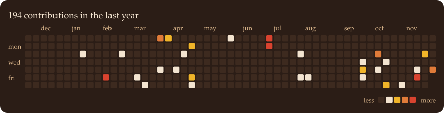

  

I spend most evenings somewhere between a timeline and a terminal: cutting video, nudging colour, and writing the little tools that make that work less tedious. Lately that means GPU video effects, dataset tooling, and MCP servers that let an agent drive DaVinci Resolve and Blender.

### ☕ what's on the desk right now

- Polishing **[TEMPORAL](https://github.com/AllastorV/temporal)**, now out as [1.0.0](https://github.com/AllastorV/temporal/releases/tag/v1.0.0). The floating Temporal Panel is still in beta and gets a little better every evening.
- Helped [**davinci-resolve-mcp**](https://github.com/samuelgursky/davinci-resolve-mcp) feel at home on Windows: the source-media guard now knows where Windows keeps its temp files ([#277](https://github.com/samuelgursky/davinci-resolve-mcp/pull/277), merged).

### 🎞️ things i've made

**[TEMPORAL](https://github.com/AllastorV/temporal)**: an OpenFX suite for DaVinci Resolve whose effects look beyond the current frame. Twenty-four of them: echoes, slow shutters, halation that lingers, rain on glass, printed paper, blob tracking. One-click Windows installer.
 c++ · cuda · openfx

**[FIXER](https://github.com/AllastorV/Fixer)**: real film stocks for DaVinci Resolve, built from the manufacturers' datasheets. Forty-two Kodak, Fujifilm and Ilford stocks with print film, grain and halation, plus a reference match that grades your shot from a still. CUDA and OpenCL builds.
 c++ · cuda · opencl · openfx · python

**[Corridorkey-Relay](https://github.com/AllastorV/Corridorkey-Relay)**: a free, unofficial OpenFX plugin that hands your Resolve clips to CorridorKey 2.0 and brings the key back.
 c++ · openfx

**[LoRA-Harvester](https://github.com/AllastorV/LoRA-Harvester)**: point it at a pile of video and get back a tidy, captioned LoRA dataset. It finds people, crops them, drops the blurry frames and sorts faces into characters.
 pytorch · yolov8 · sam2 · pyqt5

**[ntsCuda](https://github.com/AllastorV/ntsCuda)**: that warm, smeary VHS look, rendered on the GPU in real time. A CUDA fork of ntscQT.
 python · cuda

**[sd-forge-img2img-tagger](https://github.com/AllastorV/sd-forge-img2img-tagger)**: one click in Forge for WD14 tags and Florence-2 captions.
 python · stable diffusion forge

**[sd-forge-auto-censor](https://github.com/AllastorV/sd-forge-auto-censor)**: one-click detection and censoring for Forge, with mosaic, blur, bars and a brush mask for touch-ups.
 python · nudenet · stable diffusion forge

**[dikte](https://github.com/AllastorV/dikte)**: voice dictation for Windows from the tray, with a glass overlay and voice commands for Claude Code. A Windows port of [yusufipk/dikte](https://github.com/yusufipk/dikte).
 python

### 🔥 a year at the desk

### 🕯️ the usual toolbox

 python · c++ · cuda · openfx · typescript · ffmpeg · blender · davinci resolve · after effects · premiere · mcp

pull up a chair. issues and small PRs are always welcome.

